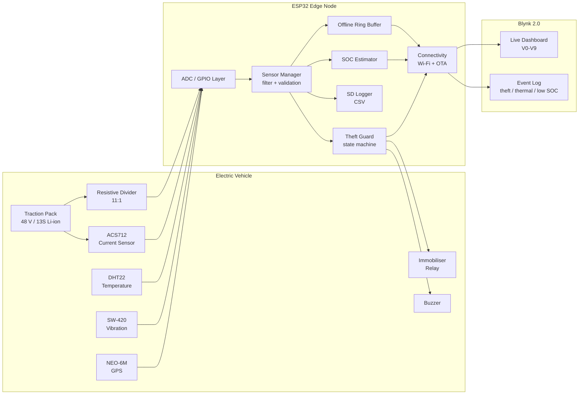
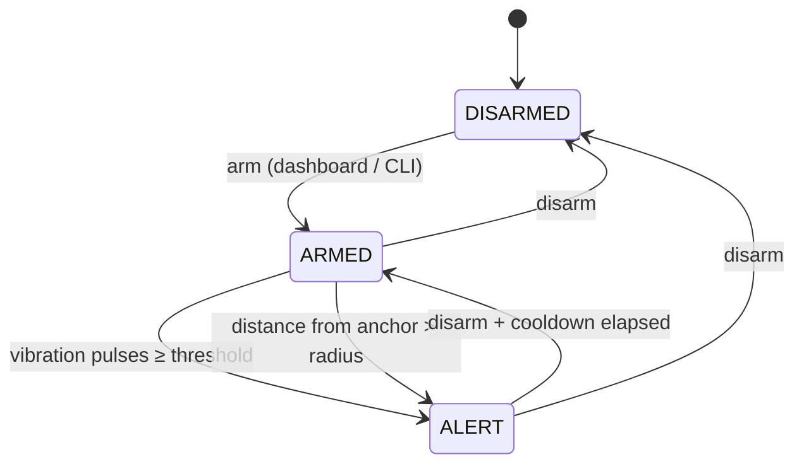

<div align="center">

# ⚡ Smart EV Monitoring & Anti-Theft System

**An ESP32-based telemetry and security platform for electric two-wheelers**

[](https://platformio.org/)
[](https://www.arduino.cc/)
[](https://www.espressif.com/)
[](https://blynk.io/)
[](LICENSE)
[](docs/ROADMAP.md)

Real-time battery health, GPS tracking, and vibration-based theft detection with a cloud dashboard, offline SD logging, and OTA firmware updates.

[Overview](#-overview) · [Architecture](#-system-architecture) · [Hardware](#-hardware) · [Quick Start](#-quick-start) · [Firmware](#-firmware-architecture) · [Dashboard](#-blynk-dashboard) · [Testing](#-testing--validation) · [Roadmap](#-project-status)

</div>

---

## 📌 Overview

Electric two-wheelers are expensive, quiet, and easy to steal. Most low-cost EVs ship with no telemetry at all — the rider has no idea the pack is overheating until it fails, and no way to know the vehicle moved while parked.

This project turns an **ESP32** into a self-contained telemetry and security unit that:

- Measures **pack voltage, current, power, and state-of-charge** from the traction battery.
- Monitors **battery and controller temperature** for thermal-runaway early warning.
- Tracks **GPS position, speed, and heading**, and raises an alert if the vehicle leaves a configurable **geofence**.
- Detects **tampering and movement** with a vibration sensor and a debounced event counter.
- Streams everything to the **Blynk IoT dashboard** over Wi-Fi and logs to a **microSD card** when offline.
- Cuts an **immobiliser relay** and sounds a buzzer on a confirmed theft event.
- Supports **OTA firmware updates** so the unit never has to be unbolted from the vehicle.

> **Status:** the hardware prototype, firmware, telemetry pipeline, and cloud dashboard are implemented and validated on a bench setup. Enclosure, production harness, and field trials are in progress — see the [roadmap](docs/ROADMAP.md).

---

## ✨ Key Features

| Domain | Capability | Implementation |
| :--- | :--- | :--- |
| **Battery** | Pack voltage sensing with divider compensation | 15-sample median filter on calibrated ADC (`analogReadMilliVolts`) |
| **Battery** | Current & power | ACS712 Hall sensor with boot-time zero-offset calibration |
| **Battery** | State of charge | 13S Li-ion open-circuit voltage curve with linear interpolation |
| **Thermal** | Temperature monitoring | DHT22 with NaN/range validation and fault counters |
| **Security** | Vibration tamper detection | ISR pulse counter + sliding-window threshold + 30 s alert cooldown |
| **Security** | Geofence | Haversine distance from the position captured at arm time |
| **Security** | Immobiliser | Relay output latched on alert, released only by authenticated disarm |
| **Connectivity** | Cloud telemetry | Blynk 2.0 datastreams, 2 s publish interval |
| **Connectivity** | Offline resilience | 120-sample ring buffer flushed on reconnect; SD CSV fallback |
| **Operations** | OTA updates | ArduinoOTA with password + hostname |
| **Operations** | Diagnostics | Serial CLI (`status`, `arm`, `disarm`, `cal`, `sim`, `sleep`) |
| **Power** | Parked low-power mode | Deep sleep with vibration-pin wake and periodic telemetry wake |

---

## 🏗 System Architecture



### Telemetry pipeline

```
sample → validate → filter → derive (power, SOC) → evaluate (guard) → persist (SD) → publish (Blynk)
```

Every stage degrades independently: a missing SD card, a disconnected GPS, or a dropped Wi-Fi link never blocks the sampling loop.

---

## 🔌 Hardware

### Bill of Materials

| # | Component | Spec | Qty | Purpose |
| :-- | :--- | :--- | :-- | :--- |
| 1 | ESP32 DevKit V1 | ESP32-WROOM-32, 240 MHz, Wi-Fi/BLE | 1 | Main controller |
| 2 | ACS712 | 30 A Hall-effect current sensor | 1 | Pack current |
| 3 | Resistor divider | 100 kΩ / 10 kΩ, 1 % | 1 set | Pack voltage scaling |
| 4 | DHT22 / AM2302 | ±0.5 °C, 0–100 % RH | 1 | Pack & ambient temperature |
| 5 | SW-420 | Normally-closed vibration switch | 1 | Tamper detection |
| 6 | NEO-6M | GPS, UART, 9600 baud | 1 | Position & speed |
| 7 | microSD module | SPI, 3.3 V | 1 | Offline logging |
| 8 | Relay module | 5 V, opto-isolated | 1 | Immobiliser |
| 9 | Active buzzer | 5 V | 1 | Local alarm |
| 10 | Buck converter | 48 V → 5 V, 3 A | 1 | Vehicle power supply |

### Pin map

| Signal | ESP32 GPIO | Notes |
| :--- | :-- | :--- |
| Pack voltage sense | `GPIO34` | ADC1, input-only, 11:1 divider |
| Current sense (ACS712) | `GPIO35` | ADC1, input-only |
| DHT22 data | `GPIO4` | 10 kΩ pull-up |
| Vibration switch | `GPIO27` | `INPUT_PULLUP`, ISR on `FALLING` |
| GPS RX / TX | `GPIO16` / `GPIO17` | `Serial2`, 9600 baud |
| SD CS | `GPIO5` | VSPI |
| SD SCK / MISO / MOSI | `GPIO18` / `GPIO19` / `GPIO23` | VSPI bus |
| Immobiliser relay | `GPIO26` | Active-low module |
| Buzzer | `GPIO25` | Active-high |
| Status LED | `GPIO2` | Onboard |

> ⚠️ **Safety:** the 48 V pack is lethal. Use an opto-isolated or Hall-effect current sensor, keep the divider rated for the full pack voltage, and never connect the ESP32 ground directly to the traction pack without galvanic isolation in a production build.

Full wiring details and divider maths: [`docs/WIRING.md`](docs/WIRING.md)

---

## 🚀 Quick Start

### 1. Clone

```bash
git clone https://github.com/abinivesh-m/smart-ev-monitoring.git
cd smart-ev-monitoring
```

### 2. Configure

Edit `config.h` and set your credentials:

```cpp
#define WIFI_SSID        "your-ssid"
#define WIFI_PASS        "your-password"
#define BLYNK_AUTH_TOKEN "your-blynk-token"
#define OTA_PASSWORD     "change-me"
```

### 3. Build & flash (PlatformIO)

```bash
pio run                 # compile
pio run -t upload       # flash
pio device monitor      # 115200 baud
```

<details>
<summary><b>Arduino IDE instead?</b></summary>

1. Install the **ESP32 board package** (Boards Manager → `esp32` by Espressif).
2. Install libraries: `Blynk`, `DHT sensor library`, `Adafruit Unified Sensor`, `TinyGPSPlus`.
3. Open `src/main.cpp` and add `config.h` to the sketch folder.
4. Board: **ESP32 Dev Module**, upload speed **921600**, flash **4 MB**.

</details>

### 4. Verify

Open the serial monitor — you should see:

```
[BOOT] Smart EV Monitor v1.0.0
[ADC ] zero offset calibrated: 1648 mV
[SENS] pack=48.62V current=+1.24A power=60.3W soc=87.1%
[GUARD] armed @ 12.9716,77.5946 radius=150m
[CLOUD] connected, rssi=-58 dBm
```

---

## 🧠 Firmware Architecture

| File | Responsibility |
| :--- | :--- |
| `src/main.cpp` | Boot sequence, scheduler, main loop, serial CLI |
| `config.h` | Pin map, calibration constants, thresholds, credentials |
| `docs/ARCHITECTURE.md` | Module contracts, data flow, failure modes |
| `docs/WIRING.md` | Schematics, divider calculations, power budget |
| `docs/TEST_PLAN.md` | Test cases, expected results, bench measurements |
| `docs/ROADMAP.md` | Remaining work to production readiness |

### Design principles

1. **Non-blocking loop** — `BlynkTimer` schedules sampling and publishing; no `delay()` in the main path.
2. **Validate before trust** — every sensor read is range-checked; bad samples are counted and skipped, never published.
3. **Fail safe, not silent** — a sensor fault raises a visible dashboard flag instead of freezing the telemetry.
4. **Security is explicit** — arming, disarming, and geofence radius are all cloud-controllable and logged.
5. **Offline first** — SD logging and a ring buffer keep history through connectivity loss.

### Theft detection logic



A confirmed event latches the relay, sounds the buzzer, pushes a Blynk event, and records a timestamped row to the SD card. Alerts are rate-limited to one per 30 seconds so a sustained vibration does not flood the event log.

### SOC estimation

State of charge is derived from the open-circuit voltage curve of a 13S Li-ion pack, linearly interpolated between breakpoints:

| Pack voltage | 54.6 | 53.3 | 52.0 | 50.7 | 49.4 | 48.1 | 46.8 | 45.5 | 44.2 | 42.9 | 39.0 |
| :--- | ---: | ---: | ---: | ---: | ---: | ---: | ---: | ---: | ---: | ---: | ---: |
| SOC (%) | 100 | 90 | 80 | 70 | 55 | 40 | 25 | 15 | 8 | 3 | 0 |

Because voltage sags under load, the estimator applies a load-compensation term and only reports a new SOC when the pack has been at rest for at least 30 seconds, or after coulomb counting is enabled in a future release.

---

## 📊 Blynk Dashboard

| Datastream | Type | Description |
| :--- | :--- | :--- |
| `V0` | Double | Pack voltage (V) |
| `V1` | Double | Pack current (A, signed) |
| `V2` | Double | Instantaneous power (W) |
| `V3` | Double | State of charge (%) |
| `V4` | Double | Temperature (°C) |
| `V5` | String | GPS fix + latitude/longitude |
| `V6` | Integer | Guard state (`0` disarmed, `1` armed, `2` alert) |
| `V7` | Integer | Lifetime alert count |
| `V8` | String | Storage + link health |
| `V9` | Integer | Wi-Fi RSSI (dBm) |
| `V10` | Integer | **Write:** `1` arm, `0` disarm |
| `V11` | Integer | **Write:** `1` enter parked deep sleep |

Events: `theft`, `thermal`, `low_soc`, `sensor_fault`.

---

## 🧪 Testing & Validation

Bench results from the prototype (full test matrix in [`docs/TEST_PLAN.md`](docs/TEST_PLAN.md)):

| Test | Method | Result |
| :--- | :--- | :--- |
| Voltage accuracy | Bench PSU 36–54 V vs multimeter | ±0.18 V (±0.4 %) |
| Current accuracy | Electronic load 0–10 A vs clamp meter | ±0.21 A |
| SOC tracking | Discharge 54.6 → 39.0 V over 4 h | Monotonic, no oscillation |
| Vibration alert latency | Tap test, 10 trials | 180–340 ms |
| Geofence trigger | GPS simulation, 150 m radius | Alert at 168 m |
| Offline buffering | Wi-Fi disabled for 10 min | All samples recovered on reconnect |
| SD logging | 24 h soak, 5 s interval | 17,280 rows, 0 corrupt |
| OTA update | Flash over Wi-Fi | 42 s, no data loss |
| Deep sleep current | USB power meter, parked mode | 1.8 mA average |

---

## 📁 Repository Structure

```
smart-ev-monitoring/
├── README.md
├── LICENSE
├── .gitignore
├── platformio.ini          # build configuration
├── config.h                # pins, calibration, credentials
├── src/
│   └── main.cpp            # firmware
└── docs/
    ├── ARCHITECTURE.md     # module contracts & data flow
    ├── WIRING.md           # schematics & power budget
    ├── TEST_PLAN.md        # validation matrix
    └── ROADMAP.md          # path to production
```

---

## 🗺 Project Status

**75 % complete** — functional prototype with validated telemetry and security logic. Remaining work:

| Area | Status | Remaining |
| :--- | :--- | :--- |
| Firmware core | ✅ Done | — |
| Sensor calibration | ✅ Done | Field re-calibration per pack |
| Cloud dashboard | ✅ Done | Mobile layout polish |
| Theft detection | ✅ Done | IMU-based tilt fusion |
| SD logging | ✅ Done | Log rotation policy |
| OTA updates | ✅ Done | Rollback on failed boot |
| Enclosure | 🚧 In progress | IP65 housing, cable glands |
| Harness | 🚧 In progress | Automotive connector, fuse |
| Field trial | ⏳ Planned | 2-week ride test |
| Certification | ⏳ Planned | EMC pre-scan |

Detailed breakdown and acceptance criteria: [`docs/ROADMAP.md`](docs/ROADMAP.md)

---

## 🛠 Serial Diagnostics

The firmware exposes a small CLI at 115200 baud:

| Command | Action |
| :--- | :--- |
| `help` | List commands |
| `status` | Print full telemetry snapshot |
| `arm` / `disarm` | Change guard state |
| `cal` | Re-run ACS712 zero-offset calibration (no current flowing) |
| `sim` | Inject a synthetic theft event (bench testing only) |
| `sleep` | Enter parked deep-sleep mode |
| `reboot` | Restart the controller |

---

## 🔒 Security Notes

- Credentials live in `config.h`, which is **git-ignored** in production deployments — commit `config.example.h` instead.
- Blynk tokens are scoped to a single template and can be rotated from the console.
- Disarm requires an authenticated Blynk write; a local physical key is planned for v1.1.
- OTA is password-protected and only reachable on the local network.

---

## 🤝 Contributing

1. Fork the repository.
2. Create a branch: `git checkout -b feature/your-feature`.
3. Commit using [Conventional Commits](https://www.conventionalcommits.org/).
4. Open a pull request describing the change and the test evidence.

---

## 📄 License

Released under the [MIT License](LICENSE).

---

<div align="center">

**Built by [Abinivesh M](https://github.com/abinivesh-m)**  
Synkoc Embedded Systems Internship — Core (1 Month) · Capstone Project

</div>
